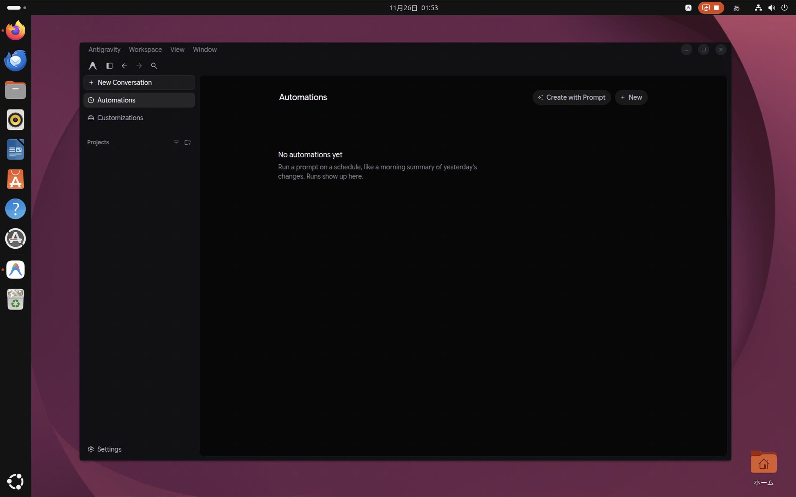

<!-- cspell:ignore asar elif EPIPE gio googleantigravity pathlib readlink setuid startswith xdg xzf -->

## はじめに

Antigravity の Linux x64 版は `tar.gz` で配布されており、展開したディレクトリにはアイコン画像や `.desktop` ファイルが含まれていません。
この記事では、Antigravity をユーザー専用のディレクトリ（`~/.local/opt/Antigravity-x64`）に展開し、Ubuntu のアプリ一覧からクリックで起動できるようにする手順をまとめます。



確認した環境と前提は次のとおりです。

- OS: Ubuntu 26.04.1 LTS（x86_64）
- Antigravity: 2.35.1（Linux x64 版）
- 必要なコマンド: `python3`、`desktop-file-validate`、`update-desktop-database`（後者 2 つは `desktop-file-utils` パッケージに含まれる）
- サンドボックスのエラー回避に Google Chrome のヘルパーを使う場合は、Google Chrome がインストール済みであること（`/opt/google/chrome/chrome-sandbox` が存在する環境）

前提のコマンドがそろっていれば、手順はすべて `sudo` を使わず一般ユーザーの権限で実行できます。

## 1. アーカイブを展開する

[Antigravity 公式ダウンロードページ](https://antigravity.google/download)から「Antigravity App」の「Linux x64」をダウンロードし、`~/Downloads/Antigravity.tar.gz` に保存します。

端末を開き、`~/.local/opt` に展開します。既存の展開先がある場合はスキップします。

```bash
mkdir -p "$HOME/.local/opt"
if [ ! -e "$HOME/.local/opt/Antigravity-x64" ]; then
  tar -xzf "$HOME/Downloads/Antigravity.tar.gz" -C "$HOME/.local/opt"
fi
```

展開すると `~/.local/opt/Antigravity-x64/antigravity` が作成されます。

## 2. 端末から起動を確認する

```bash
"$HOME/.local/opt/Antigravity-x64/antigravity"
```

ウィンドウが開いたらアプリを終了し、手順 3 に進みます。

### SUID サンドボックスのエラーが出る場合

端末に次のエラーが表示されて起動できないことがあります。

```text
The SUID sandbox helper binary was found, but is not configured correctly
```

今回の環境では、`sudo` を使わずに解決する方法として、インストール済みの Google Chrome に付属する `/opt/google/chrome/chrome-sandbox` へのシンボリックリンクに差し替えることで起動できました。

Chrome 側のヘルパーが `root` 所有かつ実行権限と setuid ビット付きであることを確認し、条件を満たせば同梱の `chrome-sandbox` を `chrome-sandbox.bundled` に退避してリンクを作成します。

```bash
app="$HOME/.local/opt/Antigravity-x64"
helper=/opt/google/chrome/chrome-sandbox
if [ -L "$app/chrome-sandbox" ] && [ "$(readlink "$app/chrome-sandbox")" = "$helper" ]; then
  echo "リンクは設定済みです"
elif [ -x "$helper" ] && [ -u "$helper" ] && [ "$(stat -c %u "$helper")" = 0 ] &&
     [ -f "$app/chrome-sandbox" ] && [ ! -e "$app/chrome-sandbox.bundled" ]; then
  mv "$app/chrome-sandbox" "$app/chrome-sandbox.bundled" &&
    { ln -s "$helper" "$app/chrome-sandbox" || mv "$app/chrome-sandbox.bundled" "$app/chrome-sandbox"; }
else
  echo "設定を中止しました。Chrome のヘルパーと既存のバックアップを確認してください。"
fi
```

設定後、もう一度 `"$HOME/.local/opt/Antigravity-x64/antigravity"` を実行してウィンドウが開くことを確かめます。

なお、この方法は Google Chrome のヘルパーに依存するため、Chrome をアンインストールするとリンクが切れます。元に戻す場合はシンボリックリンクを削除し、`chrome-sandbox.bundled` を `chrome-sandbox` にリネームしてください。

## 3. アプリ同梱のアイコンを取り出す

アイコン画像は `resources/app.asar` の中に `icon.png` として格納されています。
Python 3 の標準ライブラリで `icon.png` を取り出し、ユーザー用のアイコンディレクトリに保存します。

```bash
python3 - <<'PY'
from pathlib import Path
import json
import struct

home = Path.home()
archive = home / ".local/opt/Antigravity-x64/resources/app.asar"
with archive.open("rb") as source:
    _, header_size, _, json_size = struct.unpack("<4I", source.read(16))
    files = json.loads(source.read(json_size))["files"]
    icon = files["icon.png"]
    source.seek(8 + header_size + int(icon["offset"]))
    png = source.read(icon["size"])
    if len(png) != icon["size"] or not png.startswith(b"\x89PNG\r\n\x1a\n"):
        raise ValueError("アイコンを読み出せませんでした")

target = home / ".local/share/icons/antigravity-app.png"
target.parent.mkdir(parents=True, exist_ok=True)
target.write_bytes(png)
print(target)
PY
```

成功すると、保存先のパス（`/home/<ユーザー名>/.local/share/icons/antigravity-app.png`）が表示されます。

## 4. アプリ一覧に登録する

`~/.local/share/applications/antigravity.desktop` を作成し、構文を検証してデータベースを更新します。`desktop-file-validate` や `update-desktop-database` が見つからない場合は、事前に `sudo apt install desktop-file-utils` で導入してください。

```bash
apps="$HOME/.local/share/applications"
mkdir -p "$apps"
cat > "$apps/antigravity.desktop" <<EOF
[Desktop Entry]
Type=Application
Name=Antigravity
Exec=sh -c "exec '$HOME/.local/opt/Antigravity-x64/antigravity' >/dev/null 2>&1"
Icon=$HOME/.local/share/icons/antigravity-app.png
Terminal=false
Categories=Development;
EOF
desktop-file-validate "$apps/antigravity.desktop" &&
  update-desktop-database "$apps"
```

`Exec` で標準出力と標準エラー出力を `/dev/null` へリダイレクトしているのは、起動後に `Error: write EPIPE` のダイアログが出るのを防ぐためです。出力先のパイプが閉じた状態で `electron-log` が `console.warn` を呼び出すと、未処理例外（`Uncaught Exception`）としてこのエラーが発生します。

エラーが出ずに終了したら、Super キー（Windows ロゴのキー）を押して `Antigravity` と入力します。アイコンが表示され、クリックしてウィンドウが開けば登録完了です。

## 5. デスクトップにもショートカットを置く（任意）

デスクトップ上にもアイコンを置きたい場合は、作成した `.desktop` ファイルをデスクトップディレクトリにコピーし、信頼済み属性を設定します。

```bash
desktop_dir="$(xdg-user-dir DESKTOP)"
shortcut="$desktop_dir/Antigravity.desktop"
install -m 755 "$HOME/.local/share/applications/antigravity.desktop" "$shortcut" &&
  gio set "$shortcut" metadata::trusted true
```

デスクトップの **Antigravity** をダブルクリックして起動を確かめます。「信頼されていない」と表示された場合は、アイコンを右クリックして **「起動を許可」** を選んでください。
